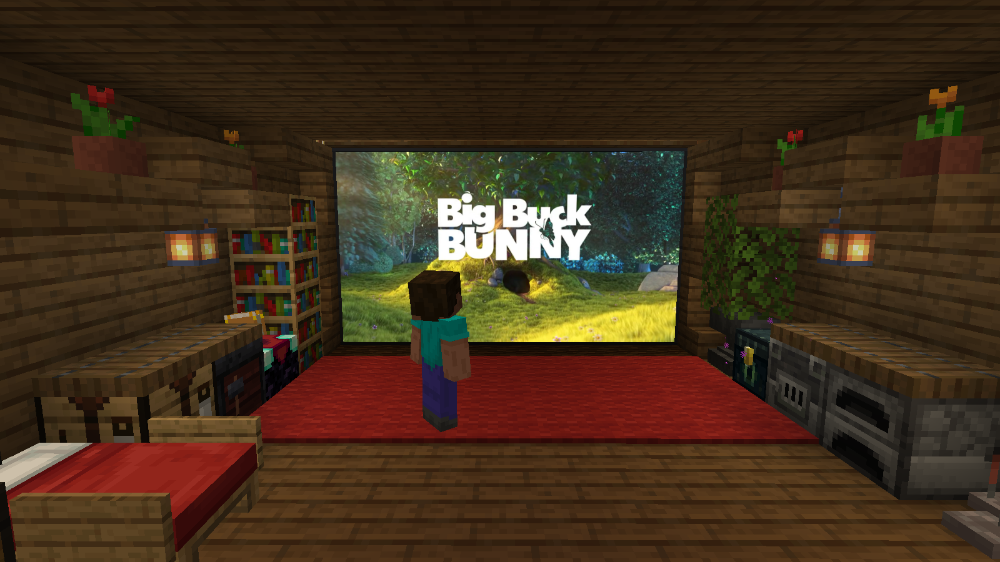

# Desktop Screens



Your real PC desktop, inside Minecraft. Build a screen of any size in your base, turn it on, and it shows your desktop, live. Walk up to it, press **G**, and your real mouse and keyboard work on it. Tap **Right Ctrl** and you're back in the game.

**Beta.** Minecraft 1.12.2 (Forge), 1.20.1 (Forge, Fabric), and 1.21.1, 26.1.2, 26.2 and 26.3 (NeoForge, Fabric). Windows 10 (version 2004 or newer) and Windows 11. Needed on the server and in each player's game. Mac and Linux players can join and watch screens shared with them.

Download: [Modrinth](https://modrinth.com/mod/desktop-screens) · [CurseForge](https://www.curseforge.com/minecraft/mc-mods/desktop-screens)

## What's in it

- **Screens:** thin panels for walls, floors and ceilings. Side by side they join into one big screen. Right-click one with an empty hand to turn it on: it shows your desktop, only to you.
- **Screen Builder:** builds a whole screen at once, up to 32 × 32 blocks, with a hologram that follows your view. Shift-click a screen to move it, resize it or take it down.
- **Tablet:** right-click it, or press G while it's in your inventory.
- **Its own picture on every screen:** each screen can show a different monitor or just one window.
- **Sharing:** add friends by name; they see your screen and hear your PC near it (never Minecraft or your voice chat).
- **Picture-in-picture:** a window, small in a corner while you play.

## Keys

- **G:** use the screen you're looking at (or, with a tablet in your inventory, the desktop anywhere).
- **Right Ctrl** (tap): back to the game. So does switching to Minecraft (Alt+Tab or its taskbar button).
- **Right Ctrl + M:** next monitor. **+ W:** just the window under the mouse. **+ O:** settings. **+ P:** pin a window for picture-in-picture. **+ F:** framed view. **+ S:** scaling. **+ mouse wheel** (or Up/Down): zoom.

Right Ctrl belongs to the mod while you use the desktop; use Left Ctrl for shortcuts in your apps. Every key can be changed in Controls, under "Desktop Screens".

## For servers and modpacks

- Nothing to install besides the jar (and Fabric API on Fabric; Mod Menu is optional).
- The Screen Builder asks land-claim mods before it builds, moves or takes down a screen (tested with FTB Chunks, Open Parties and Claims and Flan; FTB Utilities on 1.12.2).
- Recipes are data files. Server settings are in `config/desktopscreens-server.properties`: the biggest screen, the builder's range, and whether sharing (and its sound) is allowed, with limits for shared pictures.

## Reporting bugs

Please open an [issue](../../issues) with your Minecraft version and loader, your Windows version and how many monitors you have, and attach `logs/latest.log` from your Minecraft folder.

## Building

Needs a Java 21 JDK; Gradle downloads the others a version needs (Java 17 for Minecraft 1.20.1, Java 25 for 26.x).

```
gradlew build                        # jars end up in versions/<version>-<loader>/build/libs
gradlew :1.21.1-neoforge:runClient   # start Minecraft 1.21.1 with the mod (NeoForge)
gradlew :1.21.1-fabric:runClient     # start Minecraft 1.21.1 with the mod (Fabric)
gradlew :1.20.1-forge:runClient      # start Minecraft 1.20.1 with the mod (Forge; also :1.20.1-fabric)
gradlew :26.3-neoforge:runClient     # and so on for 26.1.2, 26.2 and 26.3
```

`tools\server.cmd neoforge | fabric | forge | vanilla [version]` starts a local test server for those clients to join at `127.0.0.1`.

Every Minecraft version and loader from 1.20.1 on is built from the same code with [Stonecutter](https://stonecutter.kikugie.dev): where versions differ, the code says so in `//?` comments. The versions are listed in `settings.gradle.kts`, their dependencies in `stonecutter.properties.toml`.

Minecraft 1.12.2 (Forge) is a build of its own in `legacy/`: its Minecraft code is too different to share, and Forge's old toolchain ([RetroFuturaGradle](https://github.com/GTNewHorizons/RetroFuturaGradle)) doesn't mix with the newer loaders' Gradle plugins. It shares `core/`, the textures and the version number with the rest. Gradle itself runs on Java 25 there, so a Java 25 JDK has to be installed (or downloaded by building a 26.x version first); the game runs on Java 8, and the first build decompiles Minecraft (a few minutes).

```
gradlew -p legacy build              # the jar ends up in legacy/build/libs (the one without -dev)
gradlew -p legacy runClient          # start Minecraft 1.12.2 with the mod
```

Minecraft 1.12.2 comes with JNA 4, and `core/` needs JNA 5, so the 1.12.2 jar brings JNA 5 along and loads it, with the mod's client code, apart from the game's classes.

| Folder | What's in it |
|---|---|
| `core/` | Plain Java, no Minecraft: screen capture, mouse/keyboard handover, moving windows. Java 8 compatible, so every Minecraft version can use it. |
| `src/` | The Minecraft code. Loader-only code is in its own package (`com.desktopscreens.fabric`, `.neoforge`, `.forge`); `com.desktopscreens.net` stands in for networking classes Minecraft only has from 1.20.5 on. |
| `src/data/` | Recipes, loot tables and tags, one folder per data format (1.20.1's differs from 1.21.1's). |
| `versions/` | Made by the build: one folder per Minecraft version and loader, with its jar. |
| `legacy/` | Minecraft 1.12.2 (Forge), with a build of its own. |

## License

MIT, see [LICENSE](LICENSE).

The jars include [Concentus](https://github.com/lostromb/concentus) (Opus in pure Java, for the shared sound) under its BSD 3-Clause license, shipped as `LICENSE_concentus`, the Fabric jars the [Common Protection API](https://github.com/Patbox/common-protection-api) (MIT), and the 1.12.2 jar [JNA](https://github.com/java-native-access/jna) 5 (Apache 2.0 or LGPL 2.1), as its own two jars with their license files.

The picture shows *[Big Buck Bunny](https://peach.blender.org)*, © Blender Foundation, CC BY 3.0.
